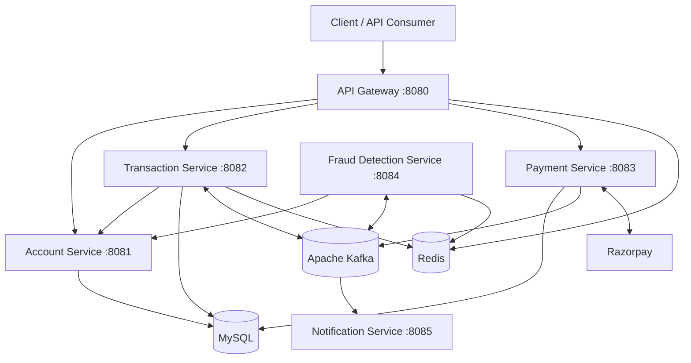

# Digital Banking System

### Event-Driven Banking Platform | Java 17 | Spring Boot | Apache Kafka | Redis | MySQL | Docker

A microservices-based digital banking backend designed around distributed services, asynchronous event processing, and independently deployable components.

The application includes account management, transaction processing, payment integration, fraud detection, and notification services. Apache Kafka supports event-driven communication, while MySQL and Redis provide persistence and in-memory data operations.

## Technology Stack

| Layer                | Technologies                             |
| -------------------- | ---------------------------------------- |
| Programming Language | Java 17                                  |
| Backend Framework    | Spring Boot                              |
| Architecture         | Microservices, Event-Driven Architecture |
| API                  | REST                                     |
| Message Broker       | Apache Kafka                             |
| Database             | MySQL 8                                  |
| In-Memory Data Store | Redis                                    |
| Payment Integration  | Razorpay                                 |
| Containerization     | Docker, Docker Compose                   |
| Build Tool           | Maven                                    |

## Key Capabilities

**Account Management**

- Account creation and retrieval.
- Balance management.
- Account blocking operations.

**Transaction Processing**

- Money-transfer workflows.
- Transaction history.
- Kafka-based transaction events.

**Fraud Detection**

- Transaction evaluation using Redis-backed data.
- Asynchronous fraud-check results.
- Fraud-detection events for downstream processing.

**Payment Processing**

- Razorpay integration.
- Payment webhook handling.
- Payment-completion events.

**Notifications**

- Event-driven transaction notifications.
- Fraud-alert processing.

**API Gateway**

- Centralized routing to backend services.
- Rate-limiting functionality.

## Microservices

| Service                 | Port | Responsibility                           |
| ----------------------- | ---- | ---------------------------------------- |
| API Gateway             | 8080 | Request routing and rate limiting        |
| Account Service         | 8081 | Account lifecycle and balance operations |
| Transaction Service     | 8082 | Transfers and transaction history        |
| Payment Service         | 8083 | Payment integration and webhooks         |
| Fraud Detection Service | 8084 | Transaction fraud evaluation             |
| Notification Service    | 8085 | Transaction and fraud notifications      |

## System Architecture



This diagram presents the application's high-level architecture. It is not intended to represent every internal method call or deployment dependency.

## Transaction Processing Flow

The following diagram illustrates the intended event-driven transaction workflow.

````mermaid
%%{init: {"theme": "dark", "themeVariables": {"primaryColor": "#1e293b", "primaryTextColor": "#ffffff", "primaryBorderColor": "#60a5fa", "lineColor": "#e2e8f0", "textColor": "#ffffff", "actorBkg": "#1e293b", "actorTextColor": "#ffffff", "actorBorder": "#60a5fa", "actorLineColor": "#cbd5e1", "signalColor": "#ffffff", "signalTextColor": "#ffffff", "labelBoxBkgColor": "#334155", "labelTextColor": "#ffffff", "loopTextColor": "#ffffff", "noteBkgColor": "#334155", "noteTextColor": "#ffffff"}}}%%

sequenceDiagram
    participant User
    participant Gateway as API Gateway
    participant Transaction as Transaction Service
    participant Kafka
    participant Fraud as Fraud Detection Service
    participant Account as Account Service
    participant Notification as Notification Service

    User->>Gateway: Submit transfer request
    Gateway->>Transaction: Route request

    Transaction->>Kafka: Publish transaction.initiated
    Kafka->>Fraud: Deliver transaction event

    Fraud->>Fraud: Evaluate fraud rules
    Fraud->>Kafka: Publish fraud.check.result

    Kafka->>Transaction: Deliver fraud result

    alt Transaction approved
        Transaction->>Account: Request account updates
        Transaction->>Kafka: Publish transaction.completed
        Kafka->>Notification: Deliver completion event
    else Transaction flagged
        Fraud->>Kafka: Publish fraud.detected
        Kafka->>Notification: Deliver fraud alert
        Kafka->>Account: Deliver fraud event
    end
```
The complete transaction workflow has not yet been validated through end-to-end testing.

## Kafka Event Topics

| Topic                   | Publisher               | Consumer                              |
| ----------------------- | ----------------------- | ------------------------------------- |
| `transaction.initiated` | Transaction Service     | Fraud Detection Service               |
| `fraud.check.result`    | Fraud Detection Service | Transaction Service                   |
| `transaction.completed` | Transaction Service     | Account Service, Notification Service |
| `fraud.detected`        | Fraud Detection Service | Account Service, Notification Service |
| `payment.completed`     | Payment Service         | Notification Service                  |

Kafka allows services to exchange events without requiring every interaction to use a synchronous HTTP request.

## Getting Started

### Prerequisites

- Docker Desktop
- Docker Compose

Java 17 and Maven are required only if running or building the services directly outside Docker.

### 1. Configure Environment Variables

Create a `.env` file in the project root using `.env.example` as a reference.

Configure the required database credentials and payment integration settings.

Never commit real credentials or API keys.

### 2. Build the Services

```bash
docker compose build
```

### 3. Start the Application

```bash
docker compose up -d
```

### 4. Verify Containers

```bash
docker compose ps
```

### 5. Check Account Service Health

```bash
curl http://localhost:8081/actuator/health
```

Expected response when the service is healthy:

```json
{
  "status": "UP"
}
```

### 6. Stop the Application

```bash
docker compose down
```

## Local Deployment Verification

The following checks were completed in the local Docker development environment:

| Verification                            | Result           |
| --------------------------------------- | ---------------- |
| Build all six application images        | Passed           |
| Start all ten Docker Compose containers | Passed           |
| Account Service health endpoint         | `UP`             |
| End-to-end money transfer               | Not yet verified |
| Fraud-detection event flow              | Not yet verified |
| Payment gateway integration             | Not yet verified |

## Project Structure

```text
digital-banking-microservices/
|
|-- account-service/
|-- transaction-service/
|-- payment-service/
|-- fraud-detection-service/
|-- notification-service/
|-- api-gateway/
|
|-- docker-compose.yml
|-- .env.example
|-- .gitignore
|-- README.md
```

## Documentation

| Document                                       | Description                                                   |
| ---------------------------------------------- | ------------------------------------------------------------- |
| [System Architecture](docs/architecture.md)    | Microservices architecture, infrastructure, and communication |
| [Transaction Flow](docs/transaction-flow.md)   | Kafka transaction lifecycle and fraud-detection workflow      |
| [API Documentation](docs/api-documentation.md) | REST endpoints and request examples                           |
| [Setup Guide](docs/setup-guide.md)             | Local Docker deployment and troubleshooting                   |

## Planned Improvements

- Automated integration testing for banking workflows.
- Enhanced fraud risk scoring.
- Distributed tracing across microservices.
- Centralized monitoring and observability.
- CI/CD automation.
- Resilience testing for asynchronous event processing.

## Development and Attribution

This project builds upon the Digital Banking System microservices implementation by **Ranbir Singh**.

The existing implementation provides the banking services and their underlying application logic.

Local development work includes updates to Docker-based builds, environment-variable configuration, deployment setup, and project documentation.

Future independently implemented enhancements will be documented separately.

Redistribution of the original implementation is subject to the original author's permission and applicable license terms.
````
