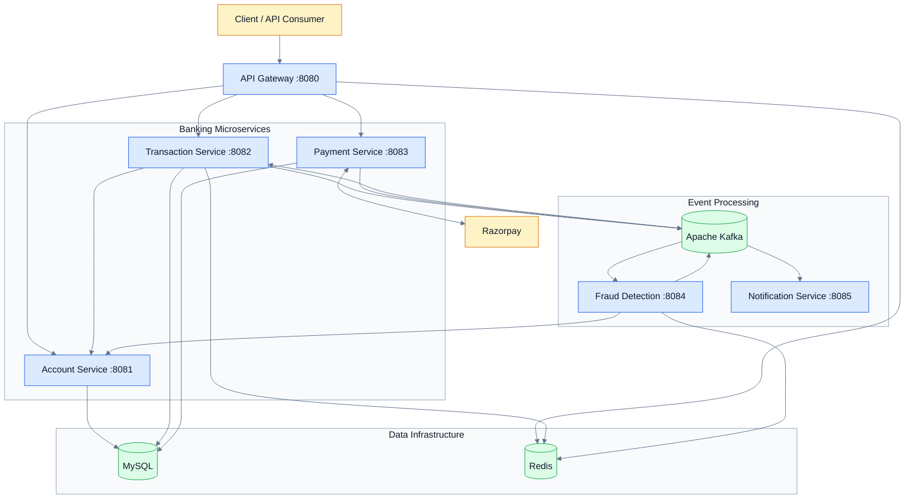

# System Architecture

**Project:** Digital Banking System
**Documentation:** Ranbir Singh

## 1. Architecture Overview

The Digital Banking System uses a microservices architecture with six Spring Boot applications.

Each application is packaged as a separate Docker image and deployed alongside the supporting infrastructure using Docker Compose.

The system combines synchronous REST communication with asynchronous Kafka events.

## 2. High-Level Architecture

The diagram shows the intended logical architecture. Individual communication paths should be confirmed against the application implementation.

## 3. Service Responsibilities

| Service                 | Responsibility                            |
| ----------------------- | ----------------------------------------- |
| API Gateway             | Central request routing and rate limiting |
| Account Service         | Account management and balance operations |
| Transaction Service     | Transaction processing and history        |
| Payment Service         | Payment integration and webhook handling  |
| Fraud Detection Service | Fraud evaluation using Redis and Kafka    |
| Notification Service    | Transaction and fraud-event notifications |

## 4. Communication Patterns

### Synchronous Communication

REST APIs support direct interactions between services.

The API Gateway provides a central entry point for client requests.

### Asynchronous Communication

Apache Kafka supports event-driven communication between the transaction, fraud-detection, account, payment, and notification components.

The architecture defines the following Kafka topics:

| Topic                   | Publisher           | Consumer              |
| ----------------------- | ------------------- | --------------------- |
| `transaction.initiated` | Transaction Service | Fraud Detection       |
| `fraud.check.result`    | Fraud Detection     | Transaction Service   |
| `transaction.completed` | Transaction Service | Account, Notification |
| `fraud.detected`        | Fraud Detection     | Account, Notification |
| `payment.completed`     | Payment Service     | Notification          |

## 5. Data Management

**MySQL**

Provides relational persistence for the account, transaction, and payment services.

The Docker Compose configuration defines separate databases:

- `account_db`
- `transaction_db`
- `payment_db`

These databases share a MySQL container in the local development environment.

**Redis**

Supports in-memory operations used by the API Gateway, Transaction Service, and Fraud Detection Service.

## 6. Deployment Architecture

The development environment uses Docker Compose to coordinate:

- Six Spring Boot application containers.
- One MySQL container.
- One Redis container.
- One Kafka container.
- One ZooKeeper container.

All containers communicate through the Docker Compose `banking-network`.

## 7. Verification Status

The six application images have been built successfully, and all ten containers have started.

The Account Service health endpoint returned `UP`.

End-to-end transaction processing, fraud evaluation, and payment workflows have not yet been verified.

## 8. Potential Architecture Improvements

Future enhancements could include:

- Distributed tracing.
- Centralized logging and metrics.
- Circuit breakers and retry policies.
- Kafka dead-letter topics.
- Idempotent transaction processing.
- Automated integration testing.
