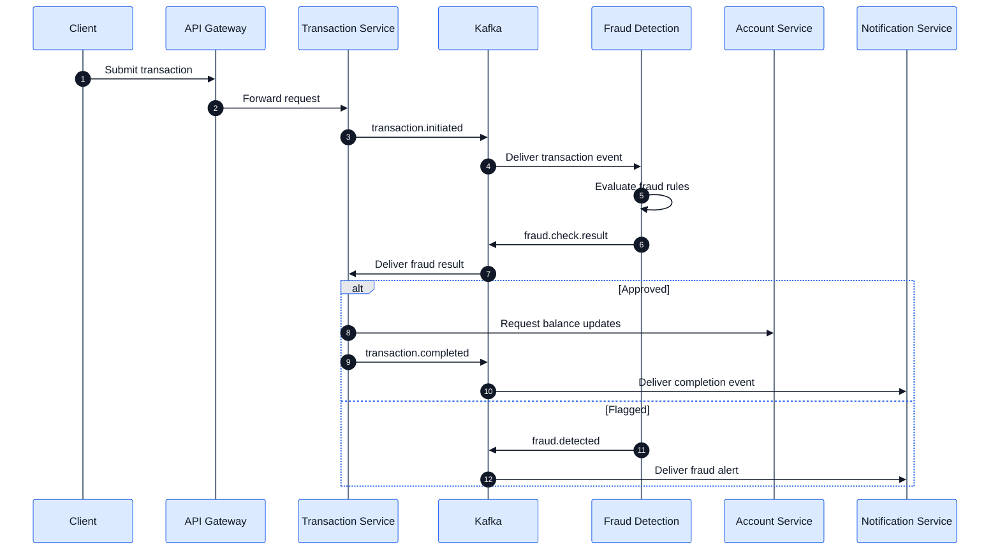

# Transaction Processing and Fraud Detection Flow

**Project:** Digital Banking System
**Documentation:** Ranbir Singh

## Overview

The banking application defines an event-driven transaction-processing workflow using Spring Boot microservices and Apache Kafka.

The Transaction Service and Fraud Detection Service communicate through Kafka events.

The following diagram represents the intended transaction lifecycle. It has not yet been validated through an end-to-end integration test.

## Transaction Sequence Diagram

## Transaction Lifecycle

### Stage 1: Transaction Initiation

A client submits a transfer request through the API Gateway.

The gateway forwards the request to the Transaction Service.

### Stage 2: Fraud Evaluation

The Transaction Service publishes a `transaction.initiated` event.

The Fraud Detection Service consumes the event and evaluates the transaction.

### Stage 3: Fraud Result

The Fraud Detection Service publishes a `fraud.check.result` event.

The Transaction Service consumes the result to determine how processing should continue.

### Stage 4: Transaction Outcome

The intended workflow branches according to the fraud-evaluation result.

An approved transaction proceeds toward account updates and transaction completion.

A flagged transaction can generate a `fraud.detected` event.

### Stage 5: Notifications

The Notification Service consumes relevant Kafka events to process transaction notifications and fraud alerts.

## Kafka Topics

| Event                   | Purpose                                         |
| ----------------------- | ----------------------------------------------- |
| `transaction.initiated` | Indicates that transaction processing has begun |
| `fraud.check.result`    | Communicates the fraud-evaluation result        |
| `transaction.completed` | Communicates transaction completion             |
| `fraud.detected`        | Indicates a fraud-detection event               |
| `payment.completed`     | Communicates payment completion                 |

## Engineering Considerations

Financial transaction processing requires careful handling of consistency and failure conditions.

Important areas for future validation and improvement include:

- Preventing duplicate transfers.
- Ensuring idempotent Kafka event handling.
- Handling insufficient balances.
- Preventing partial account updates.
- Recovering from service failures.
- Maintaining transaction audit records.
- Managing event retries and failures.

These are engineering considerations, not claims that the current implementation fully addresses them.

## Testing Status

Docker builds and application startup have been verified.

The complete transaction and fraud-detection workflow remains untested end-to-end.
